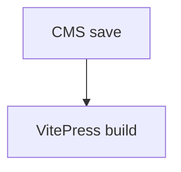

# Pages CMS 嵌套目录验证

> 仅用于 `cms-test` 分支验证 Pages CMS 保存、Markdown 处理和 VitePress 导航，验证后可删除。

## C++

```cpp
#include <iostream>
int main() { std::cout << "CMS test\n"; }
```

## MathJax

$$
T(n)=2T(n/2)+n=O(n\log n)
$$

## Mermaid

